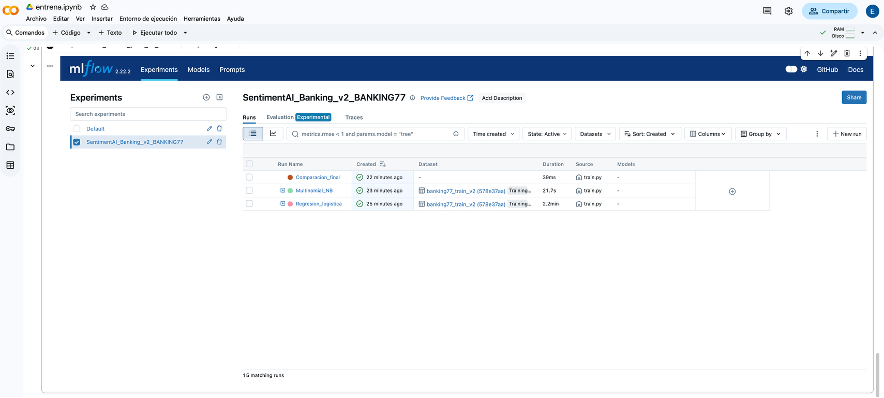
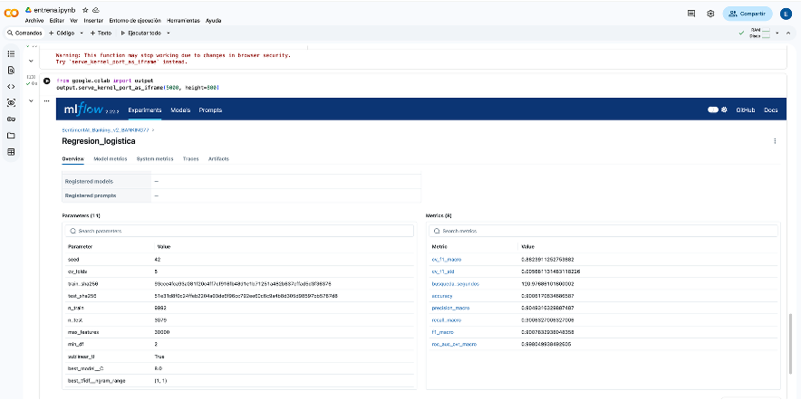
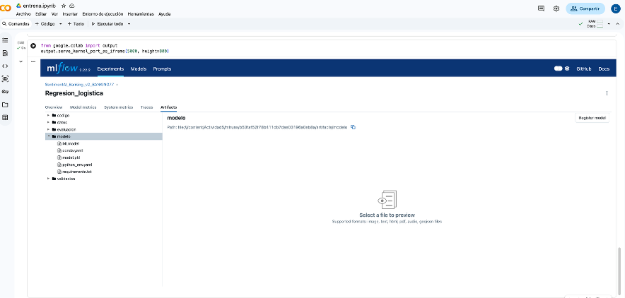
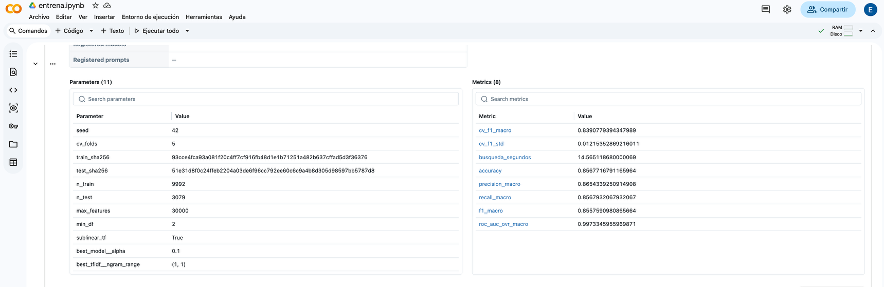
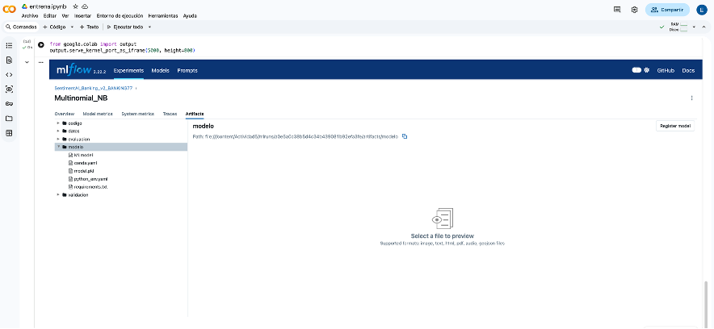
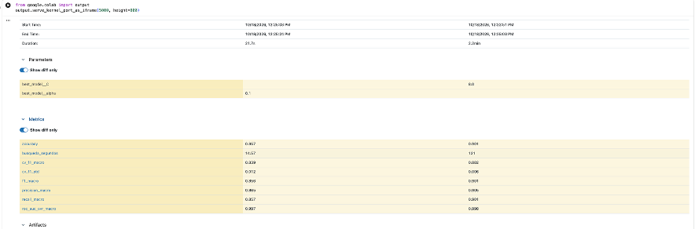

# Evidencias reales de MLflow en Colab

## 01_mlflow_experimentos.png
Experimento y ejecuciones principales (15 runs en total).

## 02_logistica_metricas.png
Regresión logística: parámetros y métricas.

## 03_logistica_artefactos.png
Regresión logística: modelo y entorno guardados.

## 04_naive_bayes_metricas.png
Naive Bayes: parámetros y métricas; alpha=0.1.

## 05_naive_bayes_artefactos.png
Naive Bayes: modelo y entorno guardados.

## 06_comparacion_modelos.png
Comparación: NB izquierda; logística derecha, identificados por alpha y C.

El archivo seguimiento_mlflow.zip conserva la base y los artefactos de la ejecución de Colab. entrena_original_colab.ipynb conserva el notebook tal como fue recibido.
