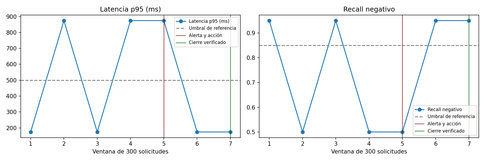

# Actividad 8 — Monitoreo de SentimentAI Banking

**Estado:** línea base ejecutada en Colab con CPU. Simulación ejecutada por reproducción de solicitudes. Visualización y corrida de incidentes en MLflow verificadas en Colab. Prueba de drift ejecutada.

## 1. Monitorización y observabilidad

El modelo clasifica comentarios bancarios como positivos, neutrales o negativos para facilitar la revisión humana. Se toma como versión estable XLM-RoBERTa, el modelo seleccionado en la [Actividad 4](../Readme.md). El [conjunto de referencia](../data/SentimentAI_Banking_Dataset_300.csv) contiene 300 comentarios sintéticos etiquetados, con 100 por clase. Se reutilizará para verificar el comportamiento durante el ejercicio.

| Indicador | Referencia histórica | Uso operativo |
| --- | ---: | --- |
| Recall de comentarios negativos | 95 de 100 | Medir cuántos comentarios negativos se detectan en la muestra etiquetada. |
| F1 macro | 0.9767 | Revisar el desempeño en las tres clases con el mismo peso. |
| Latencia individual p95 | 45.08 ms en GPU Tesla T4 | Comparar tiempos de inferencia. La línea base del servicio se medirá de nuevo en el entorno del ejercicio. |

[Resultados originales](../results/metricas_comparativas.csv) · [Revisión del modelo](../model_revisions.json)

### Línea base medida en Colab

| Indicador | Resultado |
| --- | ---: |
| Solicitudes evaluadas | 300 |
| Errores de ejecución | 0 |
| Latencia p95 | 174.45 ms |
| Solicitudes correctas en 500 ms o menos | 300 de 300 (100 %) |
| Presupuesto de error consumido | 0 de 15 incumplimientos permitidos (0 %) |
| Recall de comentarios negativos | 95 de 100 (95 %) |
| F1 macro | 0.976738 |

La prueba usó XLM-RoBERTa en CPU y midió inferencia individual dentro del cuaderno. El umbral de 500 ms se conserva para simular incidentes en este entorno. Los resultados de calidad corresponden al mismo conjunto sintético de referencia de la Actividad 4.

MLflow registró la corrida `linea-base` en el experimento `Actividad 8 - SentimentAI Banking`. La ejecución generó `solicitudes.csv` y `metricas.json`, guardados como artefactos de la corrida y exportados en `/content/evidencias_linea_base`.

- [Notebook de línea base](01_linea_base.ipynb)
- [Resumen de métricas exportado](evidencias/linea_base/metricas.json)
- [Registro de las 300 solicitudes](evidencias/linea_base/solicitudes.csv)

En cada solicitud se registrarán fecha y hora, identificador de traza, versión del modelo, etapa, duración y resultado. Las trazas desglosarán preprocesamiento, inferencia y respuesta. Los logs operativos omitirán el texto del comentario. El dashboard mostrará por ventana la latencia p95, la proporción de solicitudes lentas, el presupuesto consumido, las alertas activas y el recall negativo cuando haya etiquetas. Se propone usar MLflow para registrar la evolución de las pruebas.

Para detectar *data drift*, compararemos la distribución de longitud y la proporción de palabras fuera del vocabulario de referencia entre los comentarios históricos y una ventana reciente. Una alerta de drift abrirá una revisión de la muestra. La caída de calidad se comprobará con etiquetas.

## 2. Alertas inteligentes

SLO provisional del ejercicio: al menos el 95 % de las solicitudes válidas debe completarse correctamente en 500 ms o menos dentro de la ventana de evaluación. El presupuesto de error es el 5 % de esas solicitudes. Con 200 solicitudes, se admiten hasta 10 incumplimientos. El consumo del presupuesto se calcula como incumplimientos observados / incumplimientos permitidos.

La latencia se medirá de extremo a extremo. La línea base del cuaderno permite usar este umbral en el ejercicio. Si cambia el entorno de ejecución, se volverá a medir la línea base. Se propone exigir una muestra mínima por ventana y dos ventanas consecutivas sobre el límite para abrir un incidente sostenido, agrupar avisos por incidente activo y verificar el cierre con ventanas recuperadas. La alerta de calidad tendrá su propia condición y requerirá suficientes ejemplos negativos etiquetados.

## 3. Simulación de incidentes y runbooks

| Incidente previsto | Detección | Intervención | Verificación |
| --- | --- | --- | --- |
| Incremento de latencia | Incumplimiento sostenido del SLO y trazas que localizan el retraso | Retirar la condición que introduce la demora en la prueba | Medir de nuevo latencia y solicitudes fuera del SLO |
| Degradación en detección de comentarios negativos | Caída sostenida del recall en ejemplos etiquetados tras activar una variante de prueba | Restaurar la versión estable con el runbook de rollback | Confirmar la versión activa y volver a medir recall en la misma muestra |

### Resultados de la simulación

El p95 resume la latencia en cada ventana. La alerta de latencia se evalúa con la proporción de solicitudes que incumplen el SLO.

Se reprodujeron las 300 solicitudes originales en cada ventana. Se sumaron 700 ms en el perfil de demora. La variante degradada cambió a neutral las predicciones negativas en posiciones pares del registro (índice desde cero). Las acciones cambian el perfil de la simulación.

| Indicador | Ventana 1 · Línea base | Ventana 5 · Alerta | Ventana 7 · Recuperación |
| --- | ---: | ---: | ---: |
| Latencia p95 · incidente de latencia | 174.45 ms | 874.45 ms | 174.45 ms |
| Cumplimiento del SLO · incidente de latencia | 100 % | 0 % | 100 % |
| Consumo del presupuesto · incidente de latencia | 0 % | 2000 % (300 de 15) | 0 % |
| Recall negativo · incidente de calidad | 95 % | 50 % | 95 % |

El pico aislado de la ventana 2 quedó sin alerta. Cada incidente generó un aviso en la ventana 5, tras dos ventanas consecutivas de incumplimiento. Se retiró la demora y se ejecutó el rollback de la variante degradada, respectivamente. El cierre se verificó tras dos ventanas recuperadas.

- [Script y configuración de alertas](simular_incidentes.py)
- [Evidencia de ventanas, alertas y acciones](evidencias/incidentes/resultados.json)
- [Notebook para visualizar y registrar los incidentes en MLflow](02_incidentes.ipynb)

## 4. Respuesta automatizada

En el entorno de pruebas, la alerta confirmada de degradación restaurará la versión estable. El código registrará el motivo, las versiones anterior y posterior y el resultado de la verificación. Si la verificación falla, el incidente seguirá abierto para escalamiento. Una señal de drift iniciará revisión de datos antes de plantear un reentrenamiento.

La ejecución de Colab mostró el tablero y confirmó la corrida `simulacion-incidentes` en MLflow. El notebook exporta `dashboard_incidentes.png` y `resultados_incidentes.json`. El tablero resume ventanas de reproducción y muestra la alerta y el cierre.

### Prueba de detección de data drift

Se construyó un vocabulario con 150 comentarios, se calibraron las métricas con otros 50 y se evaluaron 100 comentarios de control antes y después de añadirles seis palabras de un tema nuevo. Los umbrales experimentales abren revisión si la mediana de longitud cambia al menos 30 % o si la proporción de palabras fuera del vocabulario aumenta al menos 15 puntos porcentuales frente a calibración.

| Ventana | Mediana de palabras | Palabras fuera del vocabulario | Alerta |
| --- | ---: | ---: | --- |
| Calibración | 9 | 20.71 % | — |
| Control | 9 | 20.34 % | No |
| Cambio sintético | 15 | 51.19 % | Sí |

La señal abre una revisión del cambio en los textos. Para determinar si afecta al modelo se necesitarían predicciones y etiquetas de esa ventana.

- [Código del detector](detectar_drift.py)
- [Resultados exportados de drift](evidencias/drift/resultados.json)
